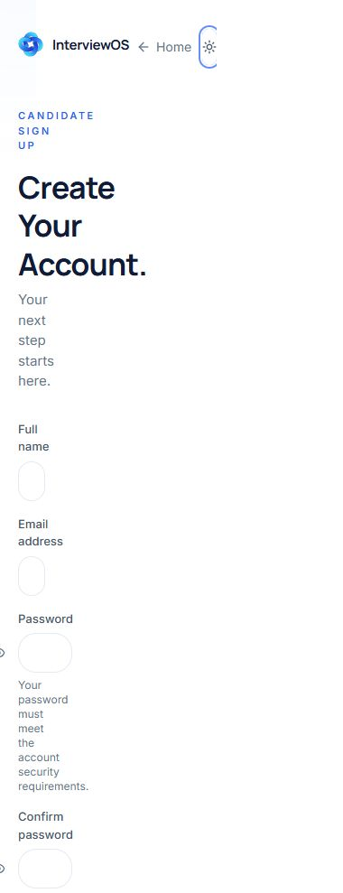
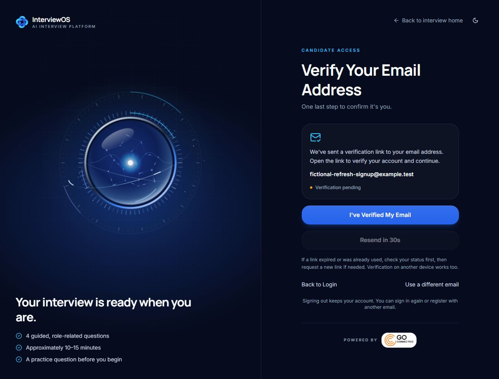
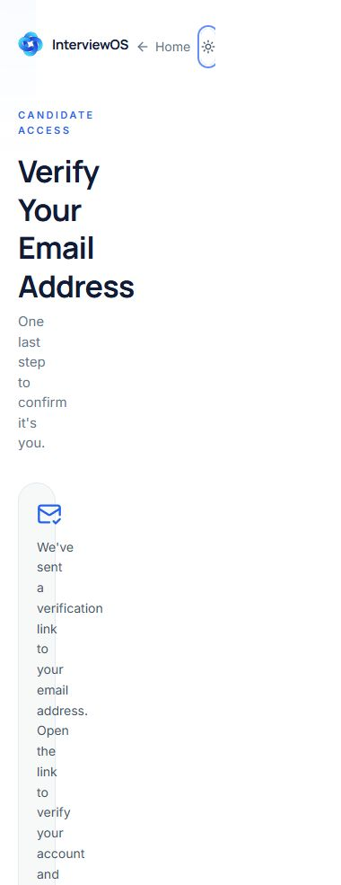

# Candidate signup, verification and account profiles

Implemented in the existing InterviewOS application on 2026-11-17. Google and email/password share Firebase sessions, NestJS authorization and PostgreSQL profiles. The existing design, branding, Light/Dark Mode and isolated Demo Mode are retained.

## Candidate journey

`/candidate/signup` → full name, email, password and confirmation → Firebase account creation → saved display name → verification email → `/candidate/verify-email` → refreshed server-side verification state → refreshed token → sign-out → `/candidate/login?verified=1` → fresh login → backend profile → authorized interview or **No Interview Linked**.

- Login retains email/password, show/hide, Forgot Password, Google and a Sign Up link.
- Signup uses the exact name after trimming leading/trailing whitespace. Passwords go directly to Firebase; they never enter NestJS, PostgreSQL, application storage or logs.
- Real registration calls Firebase `validatePassword`, so requirements come from the configured project. The isolated, non-production `demo-` Auth Emulator uses a 6–4096 character fallback because the emulator does not implement that endpoint. Real-mode policy failures remain failures.
- Account creation, name update and verification sending report partial failures accurately. An account already created is not created again when an email fails to send.
- Verification includes email, pending/success states, resend with a 60-second cooldown, manual checking, Back to Login and Use a Different Email. Checks run at most every 15 seconds for 10 minutes, pause while hidden, and stop on success/unmount/timeout. Manual checking remains available after timeout.
- Firebase `user.reload()` checks server state, including verification completed on another device. Token refresh and sign-out happen before the success redirect. A non-secret UID marker retains the fresh-login requirement across page refreshes. Verification does not call `/auth/me` or create PostgreSQL users.
- Missing account names use `/candidate/complete-profile` or `/admin/complete-profile`. There is no public admin signup. The admin completion route grants no role.

## Identity and authorization

`useUserProfile` is the shared account identity source. Stored `User.displayName` takes precedence over Firebase display name. Google supplies the initial name, verified email and optional supported profile photo; names are never fabricated. Missing names can be completed through Firebase and synchronized after a token refresh.

Account names are used in candidate header/dropdown, greetings, session header, completion, status, the unlinked-account screen, admin sidebar/topbar and HR account settings. Official applicant names remain on candidate/application/interview records; activity actor names continue to come from the corresponding PostgreSQL user. HR identity is never substituted for an applicant.

NestJS still requires a verified email for both allowed providers before user synchronization. Firebase UID remains the unique identity key. New users receive CANDIDATE only. Existing roles, ownership and staff-edited names are preserved. Auto-linking still requires a verified matching email, exactly one unowned candidate and an open unexpired invitation. No fake application is created in API Mode.

The existing `User.displayName` column is reused. Initial profile creation and missing-name completion are audited in the same transaction as the change. Audit summaries contain field names and source only, with no names, emails, passwords or tokens. Compare-and-set protects concurrent name edits. No schema migration, reset or changes to recruitment decisions were needed.

## Configuration and deployment

The existing backend uses `AUTH_MODE=firebase`, `AUTH_ALLOWED_PROVIDERS=google.com,password`, project `ai-recruitment-4d3e4` and the ignored service-account file through `GOOGLE_APPLICATION_CREDENTIALS`. Real-mode emulator flags remain disabled. Credential files and `.env` files are ignored and untracked; no credential values were displayed or committed.

The existing frontend `.env.local` contains the Firebase web configuration and API mode. It was not overwritten. Its HTTP localhost API URL is suitable for local development. Production requires the actual HTTPS API URL, an allowed backend CORS origin, and the frontend domain in Firebase Authentication's authorized domains. Google and Email/Password were previously confirmed enabled through read-only project checks. Firebase's hosted email action pages handle verification/reset; review sender branding and password policy in Firebase as needed.

The production build check uses only a process-level `NEXT_PUBLIC_API_BASE_URL=https://api.example.invalid/api/v1` override. **Rebuild with the actual HTTPS API URL before deployment.** Restart the backend to use the updated authentication service. No real OAuth popup, real registration, verification delivery or password-reset delivery was tested in this task.

## Validation

- Frontend TypeScript and ESLint passed; backend TypeScript and ESLint passed.
- Frontend: **70** passing tests covering signup/policy/errors, forms, verification polling/success/timeout/unmount, refresh/fresh-login, missing Google names, centralized identity, password reset, sign-out, API token refresh and Demo Mode/interview submission/reset.
- Backend: **71** passing isolated authentication/authorization tests, including unverified rejection, real/emulator isolation, roles, invitation/ownership restrictions, UID races, profile preservation and transactional audits.
- Firebase SDK integration: **8** passing tests against `demo-interviewos-auth-tests`, covering name persistence, password login, verification links, token refresh, sign-out/fresh login, password reset, Google name/photo, wrong project and disabled users.
- PostgreSQL integration: fictional profiles and candidate fixture inside one rollback-only transaction against the existing local test database. Name persistence, candidate-only provisioning, UID uniqueness, name/ownership preservation, missing-name completion and safe auditing passed. Zero fixture users remained. Existing records were not changed; no reset, seed or migration ran.
- Browser: actual signup, verification pending, protected-route rejection, refresh restoration, automatic verified-success redirect, fresh login, full-name display, uninvited restriction, admin restriction and logout. Screens checked at 1440 px and 390 px in Light/Dark Mode with no horizontal overflow. A verification-route hydration warning was fixed; clean-page checks reported zero console errors/warnings.
- Browser API responses used an in-memory fixture with the actual compiled NestJS token verifier and guard. PostgreSQL persistence was tested separately by the rollback-only integration. This is not a claim of testing a production deployment.
- Frontend and backend production builds passed. The frontend generated all 35 routes. Preview/emulator/API fixtures were stopped afterward; PostgreSQL was restored to its original stopped state.

## Repeat checks safely

```powershell
# Repository root
npm run typecheck
npm run lint
npm run test:auth

# Backend directory
npm run typecheck
npm run lint
npm run test:auth
npm run test:auth:db  # existing local _test database must be running; always rolls back
npm run build
```

Do not substitute the backend's general `npm test`, `test:unit` or `test:e2e`: their existing global setup resets/seeds the test database. The auth suites intentionally bypass it.

```powershell
# Root, terminal 1: isolated emulator
node interviewos-infrastructure/firebase/node_modules/firebase-tools/lib/bin/firebase.js emulators:start --only auth --project demo-interviewos-auth-tests --config tests/fixtures/firebase-emulator.json

# Root, terminal 2: actual SDK tests (build backend first)
$env:AUTH_EMULATOR_TESTS='1'
node node_modules/vitest/vitest.mjs run tests/auth/firebase-emulator.test.js
Remove-Item Env:AUTH_EMULATOR_TESTS
```

The optional browser fixture is `node tests/fixtures/auth-preview-api.mjs --emulator-only` (loopback port 3198, no database). A preview must explicitly use `NEXT_PUBLIC_APP_MODE=api`, API base `http://127.0.0.1:3198/api/v1`, project `demo-interviewos-auth-tests`, emulator host `127.0.0.1:9199`, and fictional Firebase web settings. Do not overwrite real environment files to run it.

References: [Firebase password authentication and policy](https://firebase.google.com/docs/auth/web/password-auth), [Firebase profile updates and verification](https://firebase.google.com/docs/auth/web/manage-users).

## UI previews




